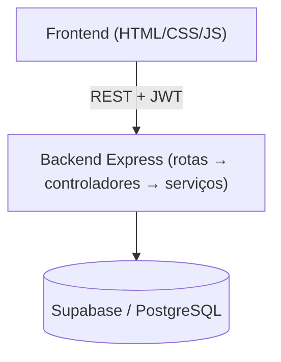

# 📝 Documentação de Melhorias — AL Cakes 2.0

> Documento no formato do template da disciplina para **Melhoria de Projeto Existente**.
> Itens marcados com `[PREENCHER]` dependem de informação da equipe (nomes, datas, métricas medidas). Itens de melhoria estão como **planejados** e só devem ser marcados como concluídos quando forem de fato implementados.

## 📋 Informações Básicas

### Nome do Projeto Original
`AL Cakes (A&L Cakes) — plataforma de pedidos para confeitaria artesanal`

### Nome da Iniciativa de Melhorias
`AL Cakes 2.0`

### Equipe de Melhorias
| Nome | GitHub | Papel Principal |
|------|--------|-----------------|
| [PREENCHER] | @[PREENCHER] | [PREENCHER] |
| [PREENCHER] | @[PREENCHER] | [PREENCHER] |

### Repositórios
- **Projeto Original**: `(https://github.com/iDneris/AL-Cakes-FullStack)`
- **Novo Repositório**: `[PREENCHER]`

---

## 📋 Contexto do Projeto Original

### 1. Descrição do Projeto Original

#### Propósito
> Sistema de vendas online para uma confeitaria artesanal: o cliente consulta o cardápio, monta o carrinho, cria o pedido e finaliza pelo WhatsApp; o administrador gerencia produtos, pedidos, clientes e equipe.

#### Origem do Projeto
- [ ] Projeto pessoal anterior
- [x] Projeto de outra disciplina
- [ ] Projeto de trabalho/empresa
- [ ] Projeto open source
- [ ] Outro

**Detalhes:**
- **Quando foi criado:** [PREENCHER]
- **Contexto:** Projeto prático de disciplina de desenvolvimento web (conforme README original).
- **Desenvolvedor(es) original(is):** [PREENCHER]
- **Status atual:** [PREENCHER]

### 2. Funcionalidades Existentes

- ✅ **Cardápio e produtos**: listagem, busca e página de detalhes de bolos (inclui bolos "sob encomenda" e controle de estoque)
- ✅ **Autenticação**: registro e login com JWT e senha com bcrypt; perfis `cliente` e `admin`
- ✅ **Carrinho de compras**: adicionar, atualizar, remover e limpar itens, persistido por usuário
- ✅ **Pedidos**: criação a partir do carrinho, listagem, detalhe, atualização de status, exclusão
- ✅ **Integração WhatsApp**: geração de mensagem de produto, carrinho e pedido, com configuração
- ✅ **Painel administrativo**: CRUD de bolos, gestão de pedidos e usuários, métricas
- ✅ **Documentação da API**: Swagger em `/api-docs`

#### Casos de Uso Existentes
1. **Finalizar pedido** — Ator: cliente logado. Fluxo: adiciona bolos ao carrinho, informa nome/telefone, confirma. Resultado: pedido `pendente` criado, estoque reduzido, carrinho limpo.
2. **Gerenciar cardápio** — Ator: administrador. Fluxo: cria/edita/desativa/reativa bolos. Resultado: cardápio atualizado.

Modelagem completa (classes, ER, casos de uso, sequência, estados): [`docs/modelagem/README.md`](modelagem/README.md).

### 3. Stack Tecnológica Original

| Componente | Tecnologia | Versão |
|------------|------------|--------|
| **Frontend** | HTML5, CSS3, JavaScript ES6+ (jQuery, SweetAlert2, Chart.js) | jQuery 3.7.1 |
| **Backend** | Node.js + Express + TypeScript | Node ≥18, Express 4.19, TS 5.4 |
| **Banco de Dados** | Supabase (PostgreSQL) | supabase-js 2.39 |
| **Outras bibliotecas** | jsonwebtoken, bcrypt, swagger-jsdoc/ui, cors, dotenv | — |
| **Deploy** | Vercel (`vercel.json`) | — |

### 4. Arquitetura Atual

- **Frontend**: páginas estáticas que consomem a API via JavaScript.
- **Backend**: API REST em camadas (rotas, middlewares de autenticação/autorização, controladores, serviços).
- **Integração**: HTTP/JSON com token JWT no cabeçalho `Authorization`.

---

## 🔍 Análise de Limitações

As limitações abaixo foram identificadas por leitura do código do projeto original.

#### Limitação 1: Rota destrutiva sem autenticação
- **Categoria**: Segurança
- **Descrição**: `DELETE /pedidos/limpar` é declarada antes do middleware `autenticacao` em `rotasPedidos.ts`, ficando acessível sem login.
- **Impacto**: qualquer pessoa pode apagar todos os pedidos.
- **Severidade**: Crítico

#### Limitação 2: Segredo JWT com valor padrão no código
- **Categoria**: Segurança
- **Descrição**: `configuracao/jwt.ts` usa um segredo fixo quando `JWT_SECRET` não está definido.
- **Impacto**: tokens podem ser forjados se o ambiente não for configurado.
- **Severidade**: Alto

#### Limitação 3: Autorização por perfil inconsistente e políticas RLS permissivas
- **Categoria**: Segurança
- **Descrição**: rotas de alterar status e excluir pedido exigem apenas login (não perfil admin); há verificação de um perfil `colaborador` que não existe no tipo `Role`; os scripts de criação de tabelas definem políticas RLS públicas (`USING (true)`).
- **Impacto**: usuários comuns podem executar ações administrativas; proteção do banco depende só da API.
- **Severidade**: Alto

#### Limitação 4: Criação de pedido sem transação
- **Categoria**: Funcional / Confiabilidade
- **Descrição**: `numero_pedido` é calculado como "maior + 1" (condição de corrida); a baixa de estoque ocorre depois da gravação do pedido e falhas apenas geram log.
- **Impacto**: números duplicados, estoque inconsistente.
- **Severidade**: Médio

#### Limitação 5: Fluxo de status sem validação e esquema divergente
- **Categoria**: Funcional
- **Descrição**: o tipo `PedidoStatus` tem 7 estados, mas o `setup-database.js` cria a coluna com apenas 4 permitidos (há script de migração separado); a API aceita qualquer transição.
- **Severidade**: Médio

#### Limitação 6: Ausência de testes automatizados e de CI
- **Categoria**: Qualidade
- **Descrição**: existe apenas um script de integração manual (`tests/integration/test-integrations.js`).
- **Severidade**: Alto

#### Limitação 7: Scripts duplicados e sem validação de entrada centralizada
- **Categoria**: Manutenibilidade
- **Descrição**: múltiplas versões de scripts (`add-sob-encomenda*.js`, `seed.js` em duas pastas, três scripts de criação de tabelas); validações de entrada espalhadas pelos controladores.
- **Severidade**: Médio

### Análise SWOT do Projeto Original

| Forças | Fraquezas |
|--------|-----------|
| Arquitetura em camadas clara; API documentada com Swagger; fluxo completo de compra | Falhas de segurança e autorização; sem testes; scripts duplicados |

| Oportunidades | Ameaças |
|---------------|---------|
| Testes + CI; modelagem formal; foco social (apoio a microempreendedores) | Exposição de dados e ações destrutivas em produção |

---

## 🚀 Melhorias Propostas

### Objetivos
1. **Tornar o sistema seguro para uso real** — métrica: 0 rotas administrativas acessíveis sem o perfil correto, verificado por testes.
2. **Garantir confiabilidade do fluxo de pedidos** — métrica: pedido, itens e estoque gravados de forma atômica; numeração sem duplicidade.
3. **Elevar a qualidade e a documentação** — métrica: suíte de testes automatizada rodando em CI e modelagem documentada.

### Melhorias Planejadas (status: **planejado**)

#### Melhoria 1: Segurança e autorização
- **Categoria**: Segurança
- **Problema**: Limitações 1, 2 e 3.
- **Solução**: proteger `/pedidos/limpar` (ou removê-la); exigir `JWT_SECRET` no startup; aplicar `autorizacao(['admin'])` onde cabe; unificar perfis; revisar políticas RLS.
- **Justificativa técnica**: princípio do menor privilégio; falhar rápido sem segredo configurado.
- **Complexidade**: Média · **Tempo estimado**: [PREENCHER] · **Responsável**: [PREENCHER]

#### Melhoria 2: Pedido transacional e máquina de estados
- **Categoria**: Correção / Refatoração
- **Problema**: Limitações 4 e 5.
- **Solução**: criar pedido, itens e baixa de estoque em uma função/transação no banco; numeração por sequence; validar transições de status conforme o diagrama de estados; alinhar o esquema do banco ao tipo `PedidoStatus`.
- **Complexidade**: Alta · **Tempo estimado**: [PREENCHER] · **Responsável**: [PREENCHER]

#### Melhoria 3: Testes automatizados e CI
- **Categoria**: Qualidade
- **Problema**: Limitação 6.
- **Solução**: testes de serviços e de rotas (autenticação, autorização, pedido); workflow do GitHub Actions executando build e testes a cada Pull Request.
- **Complexidade**: Média · **Tempo estimado**: [PREENCHER] · **Responsável**: [PREENCHER]

#### Melhoria 4: Consolidação de scripts e validação de entrada
- **Categoria**: Refatoração
- **Problema**: Limitação 7.
- **Solução**: um único fluxo de setup/migração/seed; validação de payloads centralizada em middleware.
- **Complexidade**: Baixa · **Tempo estimado**: [PREENCHER] · **Responsável**: [PREENCHER]

#### Melhoria 5: Modelagem e documentação do sistema
- **Categoria**: Documentação
- **Entrega**: [`docs/modelagem/README.md`](modelagem/README.md) com diagramas de classes, ER, casos de uso, sequência e estados, mantido atualizado conforme as melhorias.
- **Complexidade**: Baixa

#### Melhoria 6 (proposta — a definir pela equipe): Foco social
- **Ideia**: reforçar o impacto social (critério de 5 pontos) com, por exemplo, apoio a microempreendedores locais ou encomendas solidárias. **Só entra no escopo se a equipe decidir implementar.**

### Melhorias Consideradas mas NÃO Incluídas
| Melhoria | Motivo |
|----------|--------|
| Reescrita do backend em outra linguagem | Fora do escopo de 3 meses e não exigida pela disciplina |
| [PREENCHER] | [PREENCHER] |

---

## 🛠️ Especificações Técnicas das Melhorias

### Novas Tecnologias/Bibliotecas (previstas)
| Biblioteca | Propósito | Justificativa |
|-----------|-----------|---------------|
| Jest (ou Vitest) + Supertest | Testes unitários e de API | Padrão do ecossistema Node/TS |
| GitHub Actions | CI | Integrado ao GitHub exigido pela disciplina |
| Zod (ou similar) | Validação de entrada | Tipagem + validação em um só lugar |

### Migrações Necessárias
- [ ] Banco: alinhar constraint de `status` aos 7 estados; sequence para `numero_pedido`; revisão de políticas RLS.
- [ ] API: restrição de perfis em rotas de pedidos.

---

## 📅 Plano de Implementação

Cronograma de referência (ajustar às datas reais da turma: [PREENCHER]).

- **Fase 1 — Análise e preparação**: análise do código, modelagem, setup do repositório, criação de Issues e Project.
- **Fase 2 — Melhorias 1 e 2**: segurança e pedido transacional, cada uma em branch própria com Pull Request.
- **Fase 3 — Melhorias 3 e 4**: testes, CI, consolidação de scripts.
- **Fase 4 — Finalização**: correções, documentação, comparação antes/depois, apresentação.

### Estratégia de Testes
- [ ] Testes manuais das funcionalidades originais antes de alterar
- [ ] Testes automatizados de regressão (Melhoria 3)
- [ ] Comparação lado a lado (versão original vs nova)

---

## 📊 Comparação Antes/Depois

> Preencher **após** implementar e medir. Não registrar números que não foram medidos.

| Funcionalidade | Versão Original | Versão Melhorada | Status |
|----------------|-----------------|------------------|--------|
| Limpar pedidos | Sem autenticação | [PREENCHER] | [PREENCHER] |
| Criação de pedido | Sem transação | [PREENCHER] | [PREENCHER] |
| Testes automatizados | 1 script manual | [PREENCHER] | [PREENCHER] |

| Métrica de código | Antes | Depois |
|-------------------|-------|--------|
| Cobertura de testes | 0% (sem suíte) | [PREENCHER] |
| Scripts de setup duplicados | [PREENCHER] | [PREENCHER] |

Evidências visuais: `docs/antes/` e `docs/depois/` — [PREENCHER]

---

## 🎓 Aprendizados e Desafios

[PREENCHER ao longo do desenvolvimento: desafios reais, decisões técnicas e o que faríamos diferente.]

## 🔒 Considerações de Segurança

| Vulnerabilidade | Severidade | Status |
|-----------------|------------|--------|
| Rota `DELETE /pedidos/limpar` sem autenticação | 🔴 Alta | Planejado (Melhoria 1) |
| Segredo JWT padrão no código | 🔴 Alta | Planejado (Melhoria 1) |
| Autorização por perfil incompleta | 🟡 Média | Planejado (Melhoria 1) |
| Políticas RLS públicas | 🟡 Média | Planejado (Melhoria 1) |

## 🌍 Impacto das Melhorias
[PREENCHER — benefícios para usuários existentes, novos usuários e impacto social ampliado.]

## 📚 Referências
1. FOWLER, Martin. **Refactoring: Improving the Design of Existing Code**. 2ª ed. Addison-Wesley, 2018.
2. MARTIN, Robert C. **Código Limpo**. Alta Books, 2009.
3. SOMMERVILLE, Ian. **Engenharia de Software**. 10ª ed. Pearson, 2018.
4. OWASP. **OWASP Top 10**. https://owasp.org/www-project-top-ten/
5. Documentação: [Supabase](https://supabase.com/docs), [Express](https://expressjs.com), [Mermaid](https://mermaid.js.org)

## ✅ Validação das Melhorias
- [ ] Funcionalidades originais continuam funcionando
- [ ] Todas as melhorias planejadas implementadas e testadas
- [ ] README e modelagem atualizados
- [ ] Testes de regressão passando

## 📝 Changelog

### Versão 2.0 — em andamento
*(Preencher a cada melhoria concluída, com a data real.)*

## 👥 Colaboração com Projeto Original
- Licença do projeto original (MIT) respeitada — arquivo `LICENSE` mantido.
