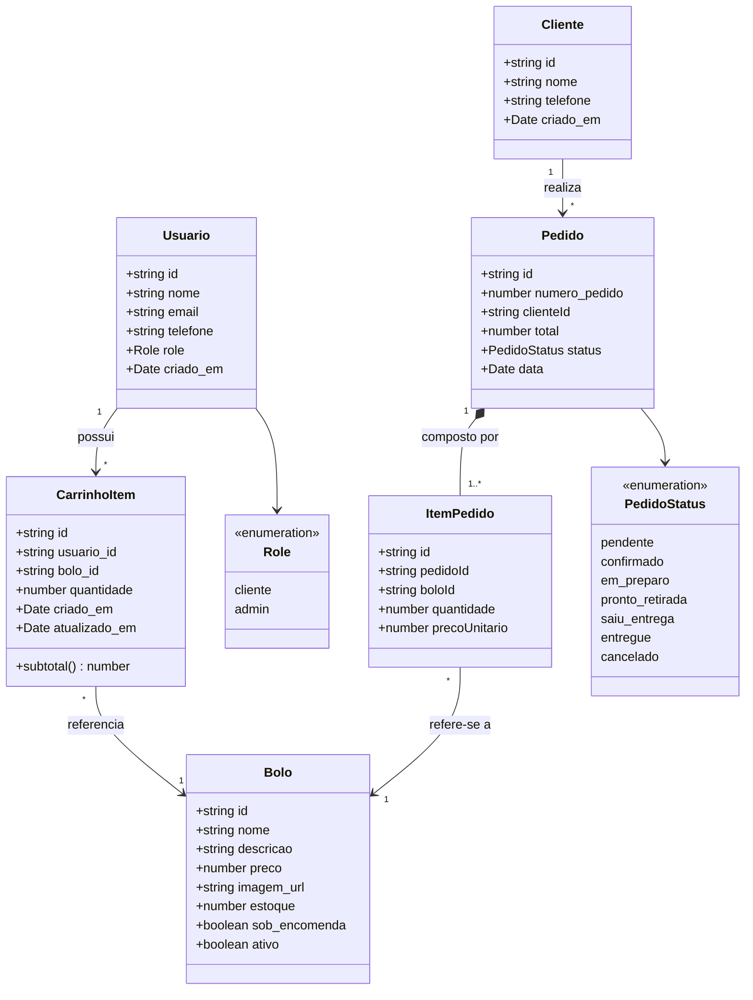
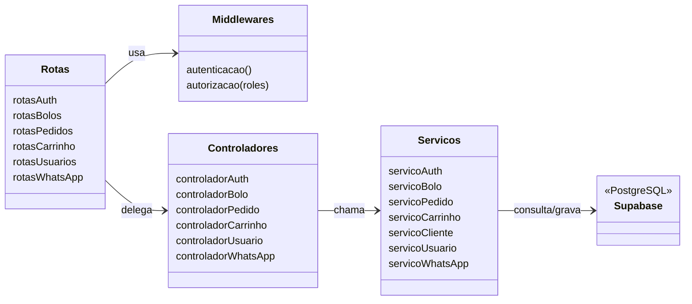
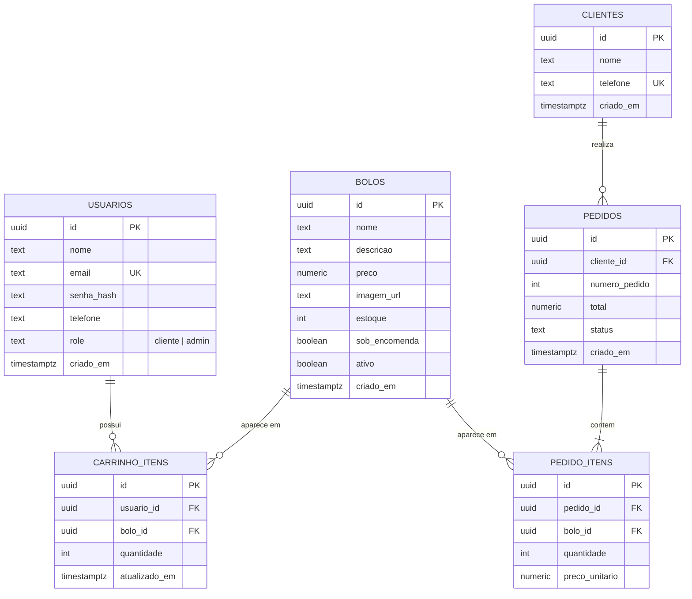
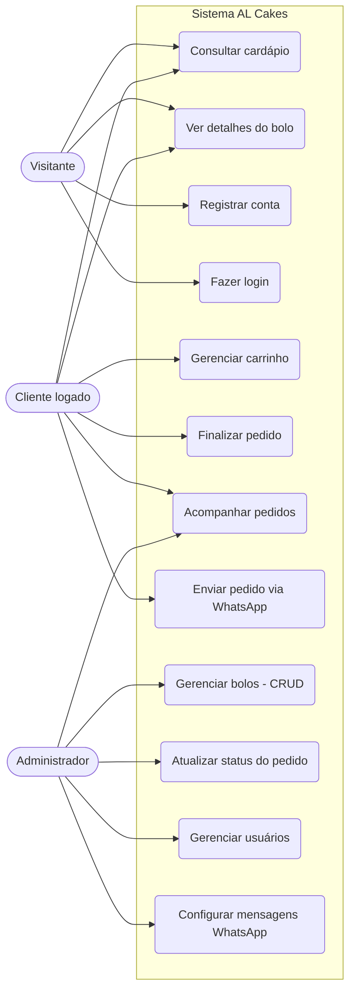
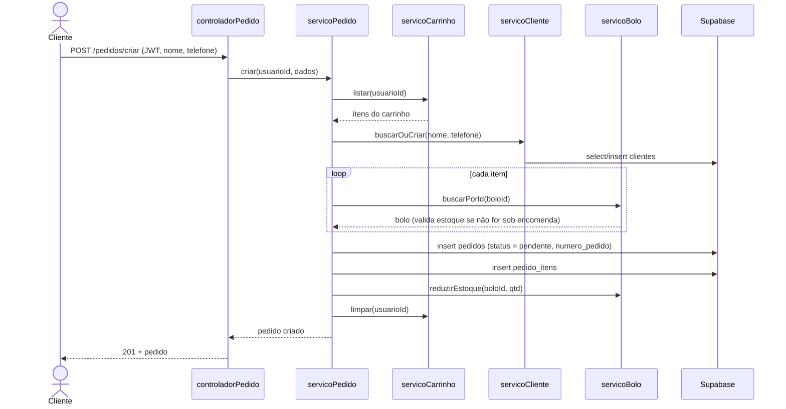
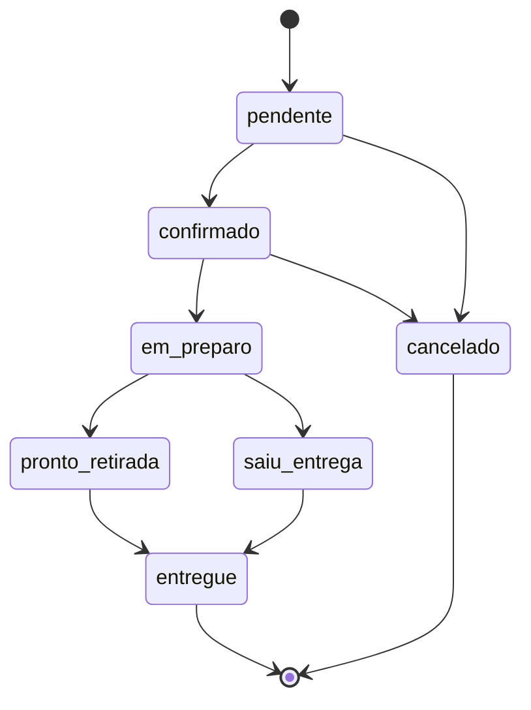
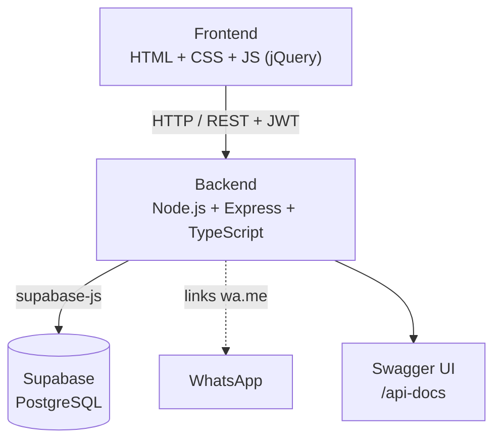

# 📐 Modelagem do Sistema — AL Cakes

Modelagem do sistema **como ele está implementado hoje** (extraída do código em `backend/src` e dos scripts de banco). Os diagramas usam Mermaid, que o GitHub renderiza automaticamente.

## 1. Diagrama de Classes (domínio)

Baseado nas interfaces de `backend/src/tipos/`.

> **Observação de modelagem:** `Usuario` (conta com login) e `Cliente` (identificado por telefone, criado/recuperado no momento do pedido) são entidades separadas no código atual. Essa duplicidade é registrada como limitação no documento de melhorias.

## 2. Diagrama de Classes (camadas da aplicação)

## 3. Modelo Entidade-Relacionamento (banco de dados)

Baseado em `backend/scripts/setup-database.js` e nas migrações em `backend/scripts/migrations/`.

## 4. Casos de Uso

## 5. Diagrama de Sequência — Finalizar pedido

Fluxo implementado em `servicoPedido.criar`.

## 6. Diagrama de Estados — Pedido

Estados definidos em `PedidoStatus` (`backend/src/tipos/Pedido.ts`).

> As transições acima representam o fluxo esperado do negócio. Hoje a API aceita qualquer troca de status (não há validação de transição); isso está listado como melhoria.

## 7. Arquitetura

